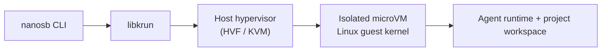

## How a Sandbox Is Built

Nanosandbox uses the same high-level flow on every host OS. The CLI starts a microVM through `libkrun`, the platform hypervisor provides hardware isolation, and a Linux guest kernel runs the workload.

This keeps the isolation boundary consistent while still using each platform's native virtualization backend.

## Workspace Sharing Across Platforms

Your project directory is mounted into the sandbox so the agent can read and edit files directly.

| Platform | Workspace mount | Permissions behavior | Extended attributes | Directory listings |
| --- | --- | --- | --- | --- |
| macOS | virtio-fs (direct) | POSIX-style | Supported | Stable |
| Linux | virtio-fs (direct) | POSIX-style | Supported | Stable |

For most users, this means package installs, builds, tests, and normal project cleanup work the same way on macOS and Linux.

## Related Reading

- [How We See Sandboxing Today](/articles/how-we-see-sandboxing-today)
- [Troubleshooting: Common Errors](/docs/troubleshooting/common-errors)
